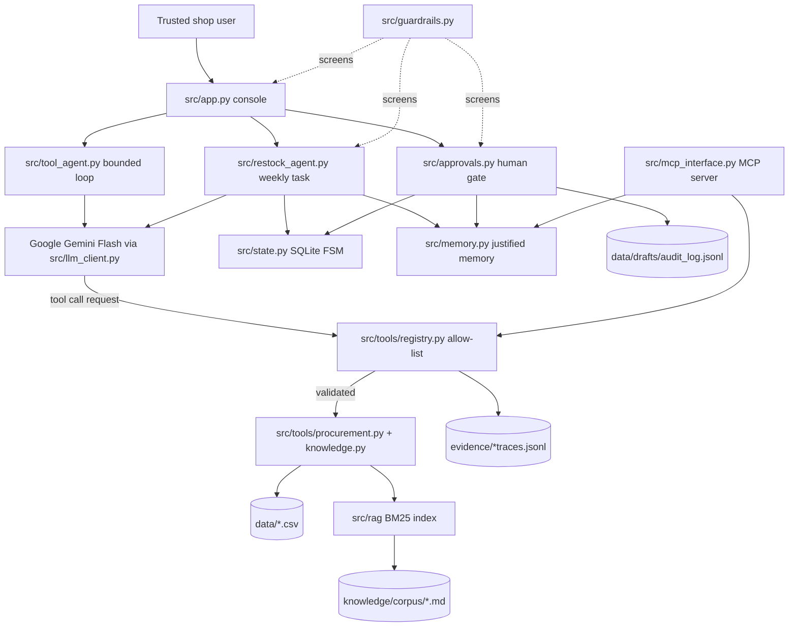
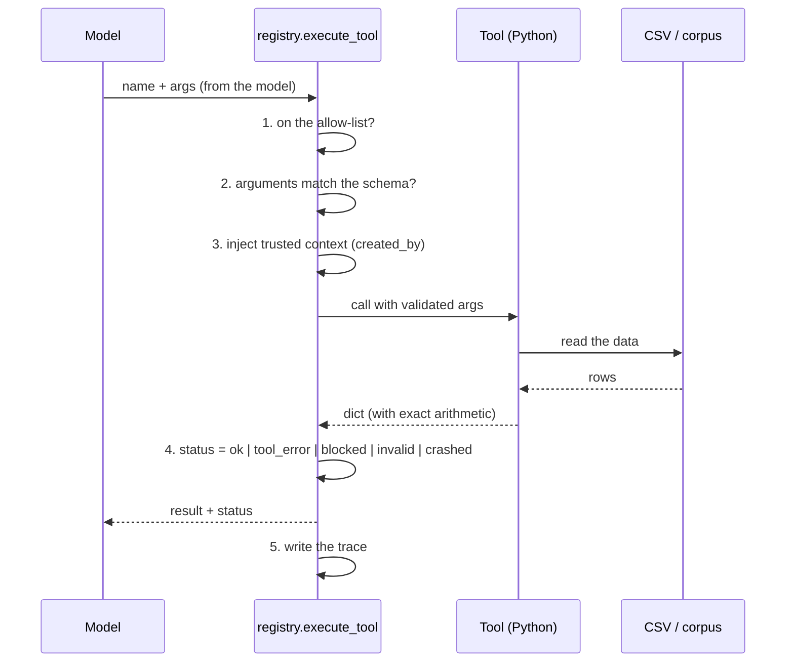
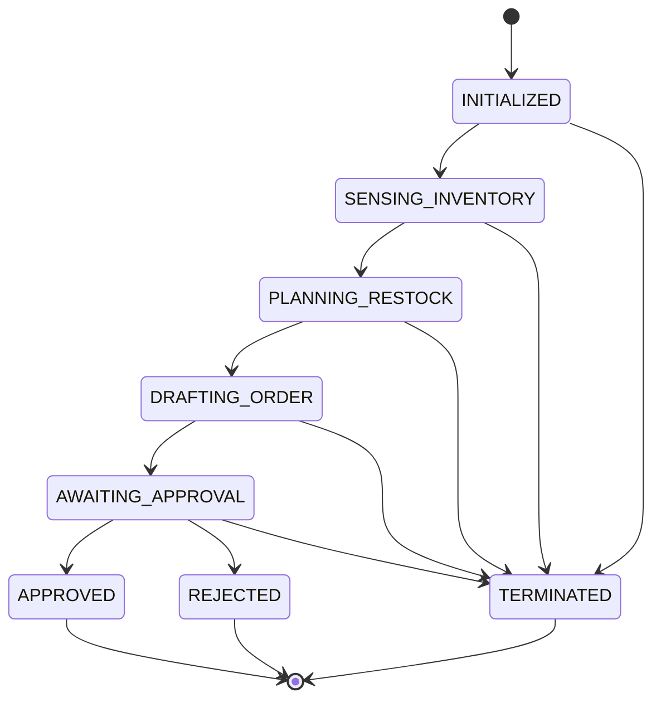

# SME Procurement Support Agent — Final Engineering Report

**Author:** Mwesigwa Arnold Mugahi (Reg No: 23/U/24738/PS, GitHub: AJmight)
**Course:** BSE4104 — Emerging Trends in Software Engineering (AI-native & agentic capstone)
**Institution:** Makerere University, Year IV, Semester I
**Date:** 20 October 2026
**Repository:** https://github.com/AJmight/Capstone_project- · **Release tag:** `v1.0.0`
**Lead Academic Convener:** Dr. Kamulegeya Grace B (PhD)

---

## 1. Executive Summary

A small stationery shop in Uganda keeps its stock levels, supplier quotes and purchase
history in spreadsheets. When the person who knows the shop is not there, the shop's
memory is lost: nobody can say what is low, how much to order, from whom, or what
the shop's own rules allow. This project builds an assistant for that situation. It
reads the shop's inventory, compares supplier quotes, computes reorder quantities,
answers policy questions from the shop's own documents, and **drafts** purchase
requisitions — which a human then reviews and approves.

The engineering argument of the project is deliberately narrow and, we believe,
defensible: **AI supports, never decides.** The language model is used only for what
a language model is good at — reading a request, choosing which of the eight
approved tools to call next, and explaining the result in the shop's language.
Every number, every rule and every permission lives in deterministic Python. There
is no tool that approves an order, signs a purchase order, pays a supplier or
contacts anybody, so the model *cannot* do those things even if it tried, and the
tests that prove it are in the repository.

Eight weeks produced a working, tested, reproducible system: **8 tools**, a bounded
agent loop, a BM25 retrieval pipeline over a 12-document policy corpus, an explicit
finite state machine, justified memory partitioned per shop, an MCP server, four
layers of deterministic guardrails, and **25 documented failures** with their root
causes, fixes and regression tests. The final offline regression is 105 of 105
across seven suites, plus 10 of 10 retrieval queries at hit@3 and 15 of 15 grounded
policy answers.

The principal limitation is not a bug but a boundary: the system is a *decision
support* tool, not an agent that can act. The value is in the draft and in the
explanation, and a shop still has to make the call.

---

## 2. Problem Context and Requirements

### 2.1 The problem

The brief's motivating story is a water-damaged exercise book: when the shop's
records are lost, the institutional knowledge goes with them. In the synthetic
scenario we model here, the shop's knowledge lives in three CSV files and a folder
of policy documents, and the person who understands them is one person with a busy
day. The task is therefore not "make decisions faster"; it is **make the shop's own
rules and numbers available and checkable, without letting a probabilistic system
make the money decisions**.

### 2.2 Users and scope

Two user roles appear in the Week 1 stories: a Procurement Officer and a Shop
Owner/Manager. In the built system they are **the same trusted user**
(`docs/requirements/decision-001-single-trusted-user.md`, 13 October 2026): a shop
of this size has one person who does the ordering, so role-based access control
would be theatre. What remains protected is the separation **between shops**, which
is enforced with a `shop_id` partition key in code (see §7.2).

In scope: inventory visibility, low-stock flagging, quote comparison, trend-based
reorder estimates, budget planning, draft requisitions, historical queries,
grounded policy answers, a manual override with an audit trail, a human approval
gate, and a 200% safety cap. Out of scope and descoped with a reason: parsing
PDF supplier quotes (user story 3) — quotes are read from `supplier_quotes.csv`,
and PDF extraction is listed as future work rather than pretending to be done.

### 2.3 User stories and acceptance criteria

Twelve stories were consolidated from the team's Week 1 document into
`docs/requirements/user-stories.md`; **eleven are implemented** and the twelfth is
descoped with a stated reason. Each story is mapped to the code that satisfies it
and to the test id that proves it (Appendix A reproduces the table).

| # | Story | Status | Evidence |
|:--:|:---|:---:|:---|
| 1 | Inventory viewing | ✅ | `get_inventory`; M-O01, M-O02, M-01, M-06 |
| 2 | Low-stock flagging | ✅ | `get_low_stock`, `estimate_reorder_quantity`; O-01, L-01 |
| 3 | PDF quote upload | ❌ descoped | quotes read from CSV; future work |
| 4 | Quote comparison | ✅ | `compare_supplier_quotes`; O-06, L-02 |
| 5 | Draft requisition | ✅ | `draft_requisition`; O-09 |
| 6 | Historical query | ✅ | `query_purchase_history`; M-O03, M-02, M-03 |
| 7 | Trend-based reorder estimate | ✅ | `estimate_reorder_quantity` `basis`; O-02, L-02 |
| 8 | Budget range (±10%) | ✅ | `draft_requisition` `budget_range_ugx`; O-09 (F-12) |
| 9 | Manual override | ✅ | `approvals.py edit`; M-O06, M-O07 |
| 10 | Manager approval | ✅ | `approvals.py`, `app.py` option 4; O-21 |
| 11 | Audit lineage | ✅ | `evidence/*traces.jsonl`, `data/drafts/audit_log.jsonl` |
| 12 | 200% safety guardrail | ✅ | `safety_cap`, `requires_override`; O-12, O-22, M-O07 |

### 2.4 The AI Boundary Matrix

`docs/requirements/ai-boundary-matrix.md` is the document that answers the brief's
central question — *where does AI add value and where must it not decide?* — and it
is enforced column by column:

| Capability | AI (model) | Deterministic core (Python) | Human | Implementation |
|:---|:---|:---|:---|:---|
| Low-stock flagging | chooses the tool, summarises | `stock <= reorder_point` | sets reorder points | `procurement.get_low_stock` |
| Quote comparison | explains the options | sorts by price, tie → lead time | may choose a dearer supplier with a written reason | `compare_supplier_quotes` |
| Reorder quantity | explains the working | `ceil(avg × 1.5) − stock`, MOQ, exact fractions | sets the quantity where there is no history | `estimate_reorder_quantity` |
| Budget planning | decides to plan, explains deferrals | urgency order, greedy fit within budget | funds deferred items or not | `plan_within_budget` |
| Draft requisition | decides which items to request | builds lines, totals, ±10% band, id, date, creator | — | `draft_requisition` |
| Policy questions | answers only from retrieved passages, cites them | BM25 retrieval, score gate, citation check | maintains the documents | `rag/`, `search_policy` |
| Manual override | — | recalculates totals and the cap, logs the original and the reason | changes the quantity, gives a reason | `approvals.edit_quantity` |
| **Approval** | **never** (no such tool exists; it refuses) | requires typed confirmation, reasons for reject and over-cap, audit log | **approves or rejects** | `approvals.decide` |
| **Ordering / payment** | **never** (refuses) | no integration exists | places the order and pays, outside the system | — |
| Access & tool control | — | tool allow-list, task allow-list, parameter validation | controls who has access | `registry.execute_tool` |

The "never" rows are the load-bearing part. They are not prompt instructions: they
are the **absence of a tool**, checked by `src/tools/registry.py` before any call
runs, and demonstrated live in the demo (§11).

### 2.5 Success criteria

The project's own success criteria, and where they ended up:

| Criterion | Result |
|:---|:---|
| The model never computes a business figure | Achieved — all arithmetic is in `src/tools/procurement.py`; F-04 is the failure that proved the point |
| The model cannot approve, order or pay | Achieved — no such tool; the allow-list refuses it (F-07) |
| Policy answers come from the shop's documents, with citations | Achieved — 15/15 grounded answers, citation checker in `rag/policy_qa.py` |
| The agent is bounded and always stops | Achieved — max 5 turns / 6 tool calls / 3 tools per task, repeat guard, code-decided outcome |
| A human can inspect what the agent did | Achieved — tool traces, agent traces, model-call traces, state-transition audit trail |
| The system runs on a clean machine | Achieved — `pip install -r requirements.txt`, one command, no database to provision |

---

## 3. System Architecture

### 3.1 The shape of the system



### 3.2 The deterministic core and the AI shell

The architecture is one sentence: **an AI shell around a deterministic core.**

| Layer | Module | Responsibility | Can it approve or pay? |
|:---|:---|:---|:---|
| Presentation | `src/app.py` | Console menu; five actions; input screening | No |
| Agentic | `src/tool_agent.py`, `src/restock_agent.py` | Bounded model↔tool loop; explicit state; code-decided outcome | No |
| Interface | `src/rag/policy_qa.py`, `src/mcp_interface.py` | Grounded answers; MCP JSON-RPC surface | No |
| Tools | `src/tools/procurement.py`, `src/tools/knowledge.py` | Every calculation and lookup; draft creation | No (drafts only) |
| Gate | `src/tools/registry.py`, `src/approvals.py` | Allow-list, argument validation, trace; the human decision | The human only |
| Safety | `src/guardrails.py` | Input screening, budget ceiling, human-only actions | No |
| State | `src/state.py`, `src/memory.py` | SQLite FSM and justified memory | No |
| Model | `src/llm_client.py` | One client, one fallback chain, one trace format | No |

A useful property of this shape: **the failure mode of the model is a bad
explanation, not a wrong transaction.** If the model is confused, the worst
possible outcome is that a human reads a confusing summary of a correct draft.

### 3.3 Data and provenance

All data is synthetic and generated with a fixed seed (`data/*.csv`): 15 inventory
items, 10 of them at or below their reorder point; supplier quotes for four
suppliers; and 24 months of purchase history. The policy corpus is 12
hand-written markdown documents with a corpus register recording who wrote each
one and why (`knowledge/corpus_register.md`). No real shop, supplier, price or
person appears anywhere in the repository.

---

## 4. Foundation Model and Prompt Engineering

### 4.1 Model choice

`docs/requirements/model-selection.md` records the decision. The runtime model is
**`gemini-3.8-flash`** through the official `google-genai` SDK, with a fallback
chain of `gemini-3.7-flash → 3.6 → 3.5 → 3.5-flash-lite → 3.1-flash-lite`.

Two things the project learned the hard way, both recorded as failures:

* **F-06 — `gemini-2.5-flash` returns 404 for this key.** It was still listed in
  the model catalogue, so a chain that trusted the list failed on the first call.
  The fix was `src/test_models.py --probe`, a script that calls a model before it
  is trusted, plus removing 2.5 from the chain.
* **F-02 — the free tier allows 20 requests per model per day.** A long
  evaluation hit the quota, and the chain had to be extended and given
  wait-and-retry rounds. Every suite in the final release is therefore *offline*:
  the release can be verified on a laptop with no quota left.

The decision also has a cost: the flash tier is weaker at instruction following
than a large model, which is exactly why the *hard* requirements were moved out of
the prompt and into code.

### 4.2 Prompt engineering as version history

Prompts are versioned files in `prompts/`, and every change is a new file, a row
in that file's Version History, a row in `prompts/prompt_history.md`, and a re-run
of the tests. The progression is the clearest single piece of evidence that the
project learned from its failures:

| Version | Change and why | Result |
|:---|:---|:---|
| 1.1.0 | First working version | 7/10 cases |
| 1.2.0 | Hard rule 4 ("include only the named items"), Example D, formulas in code spans (F-01, F-03) | 10/10, then 9/10 with the checker tightened (F-05) |
| 2.0.0 | **Major**: maths moved out of the prompt and into tools (F-04) | live agent 6/6 |
| 2.1.0 | Tool descriptions tightened | traces 4/4, Week 4 regression 5/6 |
| 2.2.0 | Hard rule 3 — no draft claim without a draft (F-13) | Week 4 regression 6/6 |
| 2.2.1 | The status line only when a draft exists (F-14) | T4 clean |
| 2.3.0 | The three MVP/RAG tools added to the tool table | MVP live 4/6 (F-16) |
| 2.4.0 | Error rule for `UNKNOWN_CATEGORY` (F-16) | MVP live 6/6, Week 5 traces 4/4 |
| 2.5.0 | User roles removed (decision-001); refusals explained in the shop's terms | regression results recorded in decision-001 |
| policy_qa 1.0.0 | Separate prompt for the RAG path, with citation rules | RAG answers 15/15 |

**The most important line in that table is 2.0.0.** Before it, the prompt asked
the model to compute reorder quantities. Under injection the model produced
Erasers 70 instead of 63, Paper 50 instead of 53 and Staplers 114 instead of 88
(F-04) — a model that is *good at language* is simply not good at this arithmetic,
and no wording fixes it. Moving the arithmetic into `estimate_reorder_quantity`
and `draft_requisition` fixed the class of failure permanently, and it is the
reason the agent can be trusted with money-adjacent numbers at all.

### 4.3 Prompt discipline

Three rules held throughout, and each cost a failure to learn:

1. **Never ask for a number the code can produce.** The prompt names tools, not formulas.
2. **Never rely on the prompt for a permission.** The allow-list is in code; the prompt
   merely describes the tools (F-07 — the model called `draft_requisition` anyway).
3. **Version everything.** `prompts/archive/` keeps the old files unchanged, so the
   claim "this iteration fixed that failure" can be checked by diffing two files.

No prompt was changed in Week 8. The last three defects were in the deterministic
layer, and a prompt is not a fix for a function call.

---

## 5. Context Engineering and RAG

### 5.1 Why a corpus at all

The shop's rules — who may approve what, when a reorder point rises, how to handle
a supplier pushing a discount — live in documents, not in the CSVs. A model asked
"who can approve an 800,000 UGX requisition?" from memory will either hallucinate
or answer from its training data. The corpus makes the answer **grounded and
citable**, which is the difference between a demo and something a shop can rely on.

### 5.2 The pipeline

```mermaid
flowchart LR
    DOC[(knowledge/corpus/*.md<br/>12 documents)] --> CH[chunk by heading<br/>disclaimer lines skipped]
    CH --> TOK[tokenise + light stemmer<br/>strip y / ies]
    TOK --> BM25[BM25 index<br/>+ source register]
    Q[user question] --> TOK2[tokenise]
    TOK2 --> BM25
    BM25 --> GATE[score gate 2.0, top 3]
    GATE --> EX[next-section expansion<br/>answer may sit in the next section]
    EX --> LLM[Gemini with policy_qa_v1.0.0.md]
    LLM --> CHK[citation check<br/>every claim has a source id]
    CHK --> A[answer + [S1] citations]
```

Implementation: `src/rag/index.py` (chunking, tokenising, the BM25 index) and
`src/rag/policy_qa.py` (retrieval, the answer call, the citation check). The
`search_policy` tool exposes the same corpus to the agent, so a policy question
inside a conversation is answered the same way as a standalone one.

### 5.3 Retrieval results

`py tests\test_week3_rag.py --offline` → **hit@3 10/10, context hit 10/10, MRR 0.88**,
and the live suite answers 15/15 grounded questions with valid citations
(`docs/evaluation/week3-rag-evaluation.md`).

### 5.4 The retrieval failures we are happy to show

The brief asks for at least three retrieval failures. We have five
(`week3-rag-evaluation.md`, R-1 … R-5):

| ID | Failure | Root cause | Fix | Status |
|:---|:---|:---|:---|:---|
| R-1 | "…how many days does Kampala Office Supplies take to **deliver**…" ranked the Delivery section 5th | the stemmer kept "deliver" and "delivery" apart | strip "y"/"ies" (index v1.1.0) | Fixed — rank 2 |
| R-2 | "Sales rep pushes a today-only discount" put the answer in rank 3, just above the score gate | section chunking separates the question's words from the answer | next-section expansion in `policy_qa.retrieve()` | Mitigated |
| R-3 | Disclaimer lines became "Introduction" chunks and were retrieved for unrelated questions | boilerplate indexed as content | skip disclaimer-only introductions (73 → 61 chunks) | Fixed |
| R-4 | "who approves 800,000" returns the wrong section — keyword search cannot reason that 800,000 lies between two thresholds | keyword search, not semantic | planned: a structured `approval_threshold(amount)` tool, query rewriting, embeddings | **Open** |
| R-5 | A correct answer citing "[S1, S3]" was flagged as uncited | the parser only knew "[S1]" | parse grouped citations | Fixed |

R-4 is the most interesting one and we left it open on purpose: it is a *real*
limitation of keyword retrieval over a numeric threshold table, and the honest
fix is a structured tool, not a better regex.

### 5.5 Grounding rules

The RAG prompt forbids answering from memory and requires a `source_id` for every
claim; `policy_qa.py` then verifies that the cited ids exist in the retrieved
set. An unanswerable question returns "not in the provided documents" rather than
a guess. R-5 exists because the *checker* was once weaker than the model.

---

## 6. Tools and the Agentic Workflow

### 6.1 The eight tools

Every tool is a Python function in `src/tools/procurement.py` or
`src/tools/knowledge.py`, registered in `src/tools/registry.py` with a JSON Schema
contract, a side-effect label and a permission. The machine-readable schemas are
exported to `docs/requirements/tool-schemas.json`.

| # | Tool | Reads | Side effect | Permission |
|:--:|:---|:---|:---|:---|
| 1 | `get_low_stock` | `current_stock.csv` | none | read |
| 2 | `compare_supplier_quotes` | stock, quotes | none | read |
| 3 | `estimate_reorder_quantity` | stock, history, quotes | none | read |
| 4 | `plan_within_budget` | stock, history, quotes | none | read |
| 5 | `draft_requisition` | stock, history, quotes | **writes a draft file** | draft write |
| 6 | `get_inventory` | `current_stock.csv` | none | read |
| 7 | `query_purchase_history` | `past_purchases.csv` | none | read |
| 8 | `search_policy` | the policy corpus | none | read |

Two properties matter more than the list:

* **No tool approves, orders, pays, signs or contacts anybody.** The list above is
  the complete set. A model that asks for `approve_requisition` receives
  `UNAUTHORIZED_TOOL` from the registry (F-07, test O-15).
* **Trusted values are injected by the registry, never by the model.** `created_by`
  comes from the session; a model that tries to set it is rejected (test O-18).

### 6.2 How a tool call happens



Steps 1, 2, 4 and 5 are code. The model contributes only step "name + args", and
the registry is the gate.

### 6.3 The bounded agent

`src/tool_agent.py` is a plan–act–observe loop with hard limits: **6 model turns
and 12 tool calls** for a conversation, **5 turns and 6 tool calls** for the weekly
task, one retry per call after a `SERVICE_UNAVAILABLE`, and a repeat-call guard.
The model chooses *which* approved tool to call next and how to explain the
result; the code decides the outcome.

`src/restock_agent.py` adds the explicit task contract
(`docs/requirements/agent-task-contract.md`):

```
0. PRECONDITIONS (code)   budget a positive whole number?
1. SENSE         (code)   get_low_stock through the registry
                           nothing low -> NOTHING_TO_DO, no model call
2. PLAN/DECIDE   (model)  chooses the next tool within the contract
3. ACT           (code)   registry runs it
4. OBSERVE       (code)   explicit AgentState updated after every result
   RE-PLAN                budget too small -> drop items; a transient failure -> one retry
5. POST-CONDITIONS (code) draft == plan, total <= budget, status is DRAFT,
                           the summary says it awaits approval
6. STOP          (code)   the OUTCOME is decided by code, never by the model's wording
```

The outcome vocabulary is closed and code-decided: `DRAFT_READY`,
`NOTHING_FITS_BUDGET`, `NOTHING_TO_DO`, `PRECONDITION_FAILED`,
`POSTCONDITION_FAILED`, `BUDGET_CEILING_EXCEEDED`, `HANDOFF_MODEL_UNAVAILABLE`,
`HANDOFF_SENSE_FAILED`, `HANDOFF_NO_DRAFT`.

### 6.4 A worked example (all figures computed by the tools, not by the model)

With a budget of UGX 300,000 and the synthetic data:

* `get_low_stock` → **10 of 15** items are at or below their reorder point.
* `estimate_reorder_quantity("ITM001")` → Bic Pens (Blue): 555 purchased over 12
  months = 46.25/month; ×1.5 = 69.375; −5 in stock = 64.375; rounded up = **65**
  (cost 65 × 476 = 30,940).
* `estimate_reorder_quantity("ITM003")` → Rulers 30cm: 469/12 = 39.08/month;
  ×1.5 = 58.625; −2 = 56.625; rounded up = **57** (cost 57 × 938 = 53,466).
* `draft_requisition(["ITM001","ITM003"])` → total **UGX 84,406**, estimate band
  75,965 – 92,847, status `DRAFT - AWAITING HUMAN APPROVAL`, id
  `REQ-YYYYMMDD-HHMMSS-XXXX`, creator = the logged-in user.
* `plan_within_budget(<all low items>, 300000)` → **4 items, UGX 294,130**,
  UGX 5,870 left, 2 items deferred, 4 items that cannot be priced automatically
  and are handed to the human with a reason.

The agent then hands the draft to `src/approvals.py`, where a person approves,
rejects (with a reason) or edits a quantity first. Nothing is sent to a supplier,
because nothing in the system can send anything to a supplier.

### 6.5 What the agent may never do

It may not approve, order, pay, sign, contact a supplier, change a reorder point,
set a quantity for an item with no history, or answer a policy question from
memory. Each of these is either the absence of a tool or a rule in
`_reorder_calculation`; each has a test.

---

## 7. Memory, State and Interoperability (Week 6)

### 7.1 An explicit finite state machine

`src/state.py` stores each procurement session in SQLite and advances it only
through a declared graph:



`APPROVED` is reachable **only** from `AWAITING_APPROVAL`, and the only code that
may perform that transition is the human approval gate. This is the answer to
"how do you prove the AI cannot skip the human?": the proof is a table, a
transition log, and the absence of any other caller.

Week 8 found and closed a gap here (**F-24**): the approval gate recorded the
decision but never moved the session, so the graph was correct and the system was
not. The gate now finds the session by draft id and transitions it, with the
approver's name in the reason, and the regression test
`test_approval_moves_the_session_to_approved` proves it.

### 7.2 Justified memory, partitioned by shop

`src/memory.py` stores a small number of **justified** memories: supplier
preferences and owner feedback, never raw conversation transcripts. Every query
is `WHERE shop_id = ? AND target_key IN (...)` with a compound index, so one
shop's records can never reach another shop's session (F-17). The owner can list
and delete their own memories (`delete_memory`, `clear_shop_memories`), which is
the erasure right in the data-protection plan.

Week 8 closed a second gap here (**F-25**): the MCP server had been taking the
`shop_id` from the *model's* arguments, which handed the model the key to the
partition it had just built. The server now owns its tenant, validates it at
construction, and refuses a cross-shop request.

### 7.3 The MCP interface

`src/mcp_interface.py` implements the Model Context Protocol as a JSON-RPC 2.0
server: `initialize`, `tools/list`, `tools/call`, `resources/list` and
`resources/read`, with three permission levels (`read_only`, `draft_write`,
`admin_approval`). `admin_approval` is explicitly refused to the model.

The Week 6 unit tests verified the handshake and the tool list but never executed
a call, so a broken `tools/call` passed (**F-23**). Week 8 fixed the call and
added a test that actually runs `get_low_stock` through the server.

### 7.4 Data protection

The decision record is `docs/requirements/decision-001-single-trusted-user.md`:
one trusted user per shop, no roles, because a shop of this size has one person
who does the ordering. The separation that matters is between shops, and it is
enforced in code — the allow-list, the `shop_id` partition, the tenant bound to
the MCP server, and the fact that no tool can spend money. Known limitation, and
stated as one: there is no login, so access control is the machine's access
control.

---

## 8. Evaluation, Observability and Guardrails (Week 7 and Week 8)

### 8.1 The evaluation suites

| Suite | What it measures | Result |
|:---|:---|:---|
| `tests/test_week2_cases.py` | prompt behaviour, 10 cases | 9/10 on v1.2.0 (live) |
| `tests/test_week3_rag.py` | retrieval quality and grounded answers | hit@3 10/10, MRR 0.88; answers 15/15 (live) |
| `tests/test_week4_tools.py` | tool contracts, permissions, failure modes | **22/22** offline, 6/6 live |
| `tests/test_week5_agent.py` | the bounded agent, post-conditions, hand-offs | **17/17** offline, 4 live traces |
| `tests/test_mvp_tools.py` | the MVP console behaviours | **7/7** offline, 6/6 live |
| `tests/test_week6_state_memory.py` | FSM, memory isolation, erasure, MCP | **9/9** |
| `tests/test_week7_evaluations.py` | 31 scenarios in six categories | **31/31** |
| `tests/test_week8_release_checks.py` | the release regressions | **19/19** |

**Total offline: 105 of 105.** Every suite is model-free, so the release is
verifiable without quota.

### 8.2 The 31-scenario Week 7 suite

| Category | Scenarios | What it probes |
|:---|:---:|:---|
| Normal | 5 | stock sensing, quote sorting, MOQ arithmetic, budget planning, session progression |
| Edge | 6 | zero/negative budget, budget below MOQ, absurd budget, no history, empty prompt |
| Corrupted data | 5 | unknown item ids, SQL injection in `shop_id`, non-numeric budgets, empty payloads |
| Adversarial | 5 | prompt injection, auto-approval commands, disbursement requests, cross-shop spoofing, script payloads |
| Tool / infrastructure failure | 5 | budget overrun, missing session, corrupted memory, closed database, unauthorised transition |
| Unauthorised action | 5 | the AI attempting to approve, pay, sign a PO, or bind a supplier |

### 8.3 Observability

Four trace streams, all written by code, not by the model:

* `evidence/traces/llm_calls.jsonl` — every model call: model, round, latency, outcome.
* `evidence/week4/tool_traces.jsonl` — every tool call: run id, args, status, latency, result.
* `evidence/week5/trace_T*.md` — human-readable agent traces (Sense → Plan → Act → Observe → Stop).
* `data/drafts/audit_log.jsonl` — every human decision, with time, name, reason, the estimate band and the allocated budget.
* `state_transitions` (SQLite) — every workflow transition with its reason.

This is what "the agent can inspect what the AI did" means in practice: the demo
opens a trace file and reads a row aloud.

### 8.4 Guardrails, and the week they became real

`src/guardrails.py` holds four deterministic layers:

| Guardrail | Blocks | Called from |
|:---|:---|:---|
| `InputGuardrail.validate_user_prompt` | prompt injection and jailbreak phrasing | `src/app.py` (the console), the MCP server |
| `InputGuardrail.validate_budget` / `validate_shop_id` | impossible budgets; hostile tenant ids | `src/app.py`, `src/mcp_interface.py` |
| `BudgetCeilingGuardrail` | a draft total above the allocated budget | `src/restock_agent.py`, `src/approvals.py` |
| `HumanInTheLoopGuardrail` | the AI attempting a human-only financial action | `src/mcp_interface.py`, `src/approvals.py` |

The honest observation of Week 8: in Week 7 these guardrails were **correct and
only the tests called them**. A guardrail that the product does not use is
documentation. Week 8 wired each one into the path a user actually takes, and
added tests that fail if the wiring is ever removed.

### 8.5 The failure catalogue — 25 failures, honestly

`docs/evaluation/failure-catalogue.md` documents every failure with a symptom, a
root cause, the fix and the test that proves it. 25 failures across Weeks 2–8;
21 closed, 1 mitigated by design (F-07), 1 monitored (F-08), 1 open design note
(F-10). Six are written up as case studies, including the three Week 8 defects.

The catalogue was **re-based in Week 8**. The Week 7 draft had renumbered
failures `F-01…F-18` in a new order, so the same id meant different things in
different documents, and three of its Week 2 entries had no evidence behind them.
The final catalogue keeps the numbering the weekly evaluation documents already
used (`F-01…F-16` keep their meaning, so every cross-reference in the repository
is correct again), gives the genuinely new findings `F-17…F-25`, and **removes**
the three unsupported claims rather than renumbering them. A failure we cannot
reproduce is a hypothesis, and the catalogue does not pretend otherwise.

### 8.6 Remediation quality: the meta-finding

Almost every failure in this project had the same shape: **the unit test stopped
just short of the defect.** F-13 was found by a live regression, F-23 by reading
the call against the real signature, F-24 by noticing that two components written
in different weeks never met. The Week 8 response was to ask, for every
deliverable, "which code path does this use in production, and is it covered?" —
and to add the missing test. That question, applied to a codebase, found more
defects in one afternoon than a month of feature work.

---

## 9. Software Engineering Quality

### 9.1 Tests

105 offline assertions across seven suites, all `unittest`-based and model-free.
Expected values are **computed from the CSVs**, never typed in by hand — the
reorder quantities, totals and budget figures in the tests are derived by the
same code path the product uses, so a change in the data cannot make a test
silently wrong. Live suites are recorded separately in `evidence/` and are not
re-run until the offline suites pass, because a live suite consumes the 20
requests per day the free tier allows.

### 9.2 Configuration and secrets

`.env` is git-ignored and never committed; `.env.example` documents the four
settings (key, primary model, fallback chain, timeouts). No key appears in any
file, log, trace or screenshot. The model chain lives in one place
(`src/llm_client.py`), and every call in the system goes through it, so there is
exactly one place where a model name can be wrong — and `src/test_models.py
--probe` exists to check that before it matters (F-06).

### 9.3 Versioning discipline

Prompts are versioned files with history; code modules carry a version and a
one-line change note in their header; the failure catalogue, the prompt history
and the weekly engineering trails explain *why* each change was made. The
engineering trail for this week is
`docs/weekly-reports/week8-engineering-trail.md`.

### 9.4 Reproducibility

```powershell
git clone https://github.com/AJmight/Capstone_project-
cd Capstone_project-
py -m venv venv
.\venv\Scripts\Activate.ps1
pip install -r requirements.txt
copy .env.example .env        # add your own GEMINI_API_KEY
py tests\test_week8_release_checks.py
py src\app.py
```

The runtime SQLite store (`data/procurement.db`) is created on first run and is
git-ignored, so a clean clone behaves exactly like the development machine. The
synthetic data is generated with a fixed seed.

### 9.5 What is *not* there, and why

* **No CI pipeline.** The suites are one command each, but a hosted CI workflow
  would need repository secrets for the live suites and was not attempted in the
  time available. This is a real gap, listed in §10.
* **No web UI.** The console app is the product. `src/app.py` is written so that
  a Streamlit or Flask front end can call the same five functions; that was the
  Application/Integration Lead's task and it is not part of this release.
* **No login.** Deliberate (decision-001) and stated as a limitation.

---

## 10. Results, Limitations and Reflection

### 10.1 What works

* The architecture holds: no tool can approve, order or pay, and the refusal is
  visible in the demo.
* The tools are exactly right: 8 capabilities, deterministic, schema-validated,
  traced, and the arithmetic is correct (Bic Pens 65, Rulers 57, a two-item draft
  of UGX 84,406, a UGX 300,000 plan of 4 items and UGX 294,130).
* The agent is bounded and always stops, and the *outcome* is decided by code.
* The retrieval pipeline is good enough to answer 15 policy questions with
  citations, and honest enough to admit what it cannot do (R-4).
* The evaluation is real: 105 offline assertions, 31 adversarial scenarios, 25
  documented failures, and three defects found and fixed in the final week.

### 10.2 What does not work, or does not work well

* **Numeric threshold questions over the corpus** (R-4) — keyword retrieval cannot
  reason about ranges. A structured `approval_threshold(amount)` tool is the fix.
* **The 200% cap** (F-10) cannot be reached by the reorder formula, so it only
  guards supplier MOQs and manual edits. It is kept for that reason, but it is
  not the general safety net it looks like.
* **Prompt adherence is weaker on the flash tier** than on a large model. The
  project answered this by moving requirements into code — but it means the
  system is more code and less prompt than a demo would be.
* **No authentication, no CI, no web UI** (see §9.5).

### 10.3 Remaining risks

| Risk | Likelihood | Impact | Mitigation now |
|:---|:---:|:---:|:---|
| The model invents a figure in free text | Low | High | The prompt forbids it and every figure the user sees comes from a tool; a future check could scan the final text for unattributed numbers |
| A draft is approved on a wrong quantity | Medium | High | The approver sees the working (`basis`), the estimate band, and the 200% cap flag; the exact total is checked against the allocated budget |
| A supplier pressure prompt in free text influences the plan | Low | Medium | The plan is computed in Python from prices, not from the model's reading of a quote |
| The memory store grows or leaks across shops | Low | High | `shop_id` partitioning in SQL, the tenant bound to the MCP server, erasure functions, and an isolation test |
| Quota exhaustion during a demo | Medium | Low | the demo script has a recorded fallback; the live demo needs one question, not twenty |

### 10.4 Future work (in priority order)

1. A structured `approval_threshold(amount)` tool and a numeric-aware retriever (closes R-4).
2. A web front end over the same five functions, and a login so the single-trusted-user decision can be revisited with evidence.
3. A CI workflow that runs the seven offline suites on every push, and a nightly live suite with a stored key.
4. A "explain this number" feature: every figure in a draft links back to the CSV row and the formula that produced it.
5. Real PDF quote extraction (the descoped user story 3), with the same tool-only arithmetic discipline.

### 10.5 Reflection

The project set out to test whether an agentic system could be *useful* to a
small shop without being *responsible for* the shop's money. The answer we
reached is that those two things are not in tension, but only if the boundary is
made of code rather than instructions. Every time we were tempted to solve
something in the prompt, the fix belonged in a tool; every time we were tempted
to let the model decide, the answer belonged in a rule. The failure catalogue is
the honest record of how often we got that wrong — a false draft claim (F-13), a
budget band above the budget (F-12), an MCP server that could not call its own
tools (F-23).

The most useful thing Week 8 produced was not a feature. It was a habit: for
each deliverable, ask which production path it actually uses and whether a test
reaches it. That question found three defects in an afternoon, and every one of
them had been hiding behind a passing suite.

The second thing worth saying plainly is that the human in the loop is not a
formality that we bolted on at the end. It is the part of the design that makes
the rest possible: because the model cannot spend money, the shop can let it
draft; because the draft is auditable, the owner can check it; because the
approver's decision moves the workflow, the system can be trusted to know where
every session stands. **AI supports, never decides** is not a slogan in this
repository — it is the absence of a tool, and the presence of a test.

---

## References

1. Anthropic. *Building Effective Agents* (2024) — patterns for workflows and agents. <https://www.anthropic.com/research/building-effective-agents>
2. Lewis et al. *Retrieval-Augmented Generation for Knowledge-Intensive NLP Tasks* (NeurIPS 2020).
3. Robertson & Zaragoza. *The Probabilistic Relevance Framework: BM25 and Beyond* (2009) — the ranking function used in `src/rag/index.py`.
4. Google. *Function Calling / Tool Use with the Gemini API* — the tool-calling contract used in `src/tool_agent.py`.
5. Model Context Protocol — specification. <https://modelcontextprotocol.io>
6. Huyen, T. *AI Engineering* (2025) — Chapter 5, evaluation (the structure of the Week 7 dataset).
7. Osmani, A. *The 12-Factor Agents* (2025) — context engineering, state, guardrails.
8.OWASP. *Top 10 for LLM Applications 2025* — prompt injection and excessive agency (the categories behind the Week 7 scenarios).
9. Regulation (EU) 2016/679 (GDPR), Articles 15–18 — the erasure right implemented in `src/memory.py`.
10. BSE4104 capstone brief and the team's Week 1 document `User stories and acceptance criteria (2).docx`.

## Appendices

### Appendix A — User stories and acceptance criteria
`docs/requirements/user-stories.md` (12 stories, 11 implemented, 1 descoped with
a reason). The table is reproduced in §2.3.

### Appendix B — Tool schemas
`docs/requirements/tool-schemas.json` (exported from the code by
`docs/requirements/tool-catalogue.md` §"Tool schemas"), and the per-tool
contract — purpose, input, output, data read, permission, failure behaviour — in
`docs/requirements/tool-catalogue.md`.

### Appendix C — Prompt versions
`prompts/` (current) and `prompts/archive/` (every earlier version, unchanged) and
`prompts/prompt_history.md` (the table in §4.2 with the reason for each change).

### Appendix D — Traces
`evidence/traces/llm_calls.jsonl`, `evidence/week4/tool_traces.jsonl`,
`evidence/week5/trace_T1…T4*.md`, `data/drafts/audit_log.jsonl`, and the state
transition table in `data/procurement.db`.

### Appendix E — Failure catalogue
`docs/evaluation/failure-catalogue.md` (25 failures, 6 case studies) and the
per-week evaluations in `docs/evaluation/`.

### Appendix F — AI Engineering Log
`docs/weekly-reports/week1…week8-ai-log.md`. Summary: Claude Code (Weeks 1–5),
Google Antigravity CLI / `agy` (Weeks 6–7), Kilo (Week 8 hardening and this
report), `gemini-3.8-flash` as the runtime model, and DeepSeek, ChatGPT and
GitHub Copilot for review and completion.

### Appendix G — Demo script and presentation outline

**Live demo (4 minutes, AI Engineering Lead).**

```powershell
py src\tool_agent.py "Prepare this week's requisition. Stay under 100,000. Prioritise lowest stock." --user "Demo"
py src\approvals.py list
py src\approvals.py show REQ-XXXX
py src\tool_agent.py "Approve draft REQ-XXXX"          # the refusal
```

Narration: the model calls `get_low_stock`, then `estimate_reorder_quantity` for
each item — the arithmetic is done in Python, because in Week 2 the model got it
wrong (F-04) — then `compare_supplier_quotes`, then the plan within budget, then
it drafts. The draft is a **draft**: `py src\approvals.py list` shows it waiting,
and asking the AI to approve it produces a refusal, because no such tool exists.

**Deck outline (8 slides).** Title · The problem (the lost exercise book) · The
solution (CSV → tools → agent → draft → human approval) · Architecture (the
deterministic core and the AI shell) · The progression (one number per week) ·
The failure we fixed (F-04, and the Week 8 catch of F-23) · Guardrails and human
control · Lessons ("AI supports, never decides").
